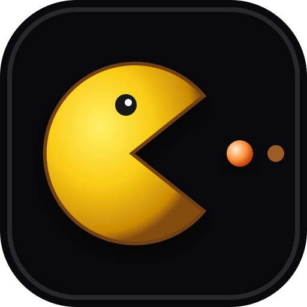
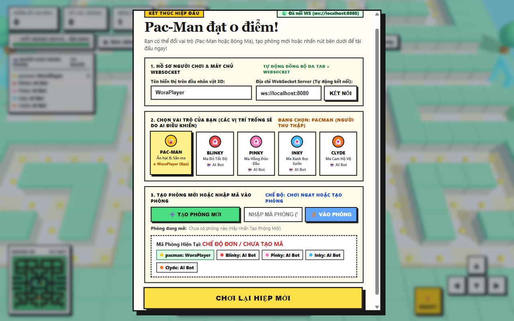

# <p align="center"><br/>PAC-MAN 3D Multiplayer (WoraWork Diorama Edition)</p>

<p align="center">
  
  
  
  
  
</p>

---

<p align="center">
  
</p>

## ✨ Tính Năng Nổi Bật

- **Đồ Họa 3D Diorama:** Xây dựng trên Three.js với hiệu ứng ánh sáng, bóng đổ mượt mà và phong cách đồ chơi diorama độc đáo.
- **Multiplayer Thời Gian Thực:** Sử dụng WebSocket Server chuyên dụng, tự động kết nối ngay khi mở game và đồng bộ vị trí, hạt đậu, điểm số giữa các người chơi.
- **3 Chế Độ Trận Đấu Linh Hoạt:**
  - **1 vs 4:** 1 Pac-Man đối đầu 4 Bóng Ma (Blinky, Pinky, Inky, Clyde).
  - **1 vs 3:** 1 Pac-Man đối đầu 3 Bóng Ma (Blinky, Pinky, Inky).
  - **2 vs 3 (Co-op):** 2 Pac-Man (Pac-Man Vàng & Pac-Man 2 Xanh) cùng hợp lực đối đầu 3 Bóng Ma với **Quỹ mạng dùng chung**.
- **Cài Đặt Phòng Tùy Biến (Dành Cho Host):**
  - **Tùy chỉnh số mạng khởi đầu:** 1, 2, 3, hoặc 5 mạng cho đội Pac-Man.
  - **Tốc độ đồng bộ mạng linh hoạt:** Điều chỉnh tần suất gửi gói tin từ 100ms đến 300ms, tự động điều chỉnh hệ số nội suy Lerp thích ứng giúp di chuyển luôn mượt mà ngay cả khi kết nối mạng không ổn định.
- **Cơ Chế Đồng Bộ Host Authority:** Chỉ định Host làm trọng tài duy nhất cho các sự kiện va chạm và bot AI, loại bỏ hoàn toàn hiện tượng lệch số mạng (desync) giữa các người chơi.
- **Tùy Biến Trực Quan:**
  - **Góc nhìn Camera:** WoraWork Follow, Toàn Cảnh 3D, Isometric 45°.
  - **Đa chủ đề:** Đảo Đồ Chơi 3D, Neon Synthwave Arcade...
  - **Kỹ năng Dash:** Nhấn `Space` để kích hoạt lướt nhanh / tốc biến né ma hoặc săn Pac-Man.

---

## 🚀 Hướng Dẫn Cài Đặt & Chạy

### Cách 1: Chạy bằng Node.js (Khuyên dùng cho phát triển)

1. **Clone repository:**
   ```bash
   git clone https://github.com/NgoMinhToan/minigame-pacman_3d.git
   cd minigame-pacman_3d
   ```

2. **Cài đặt thư viện:**
   ```bash
   npm install
   ```

3. **Khởi chạy ứng dụng:**
   ```bash
   npm start
   ```

4. **Trải nghiệm:**
   Mở trình duyệt truy cập: `http://localhost:8080` (WebSocket sẽ tự động kết nối).

---

### Cách 2: Chạy bằng Docker

#### Dùng image từ GitHub Container Registry (GHCR):
```bash
docker run -d -p 8080:8080 --name pacman3d ghcr.io/ngominhtoan/minigame-pacman_3d:latest
```

#### Hoặc tự build từ source:
```bash
docker build -t pacman_3d .
docker run -d -p 8080:8080 --name pacman3d pacman_3d
```

Sau đó mở trình duyệt tại: `http://localhost:8080`.

---

## 🎮 Phím Điều Khiển

| Phím | Chức năng |
| :--- | :--- |
| `W`, `A`, `S`, `D` hoặc `Phím Mũi Tên` | Di chuyển nhân vật trong mê cung |
| `Space` | Kích hoạt Lướt Nhanh (Dash Boost) |
| `C` | Đổi góc nhìn Camera |
| `T` | Đổi giao diện / Theme bản đồ |
| `P` hoặc nút trên màn hình | Mở Sảnh chờ / Tạm dừng |

---

## 🛠️ Cấu Trúc Dự Án

```
├── .github/
│   └── workflows/
│       └── docker-publish.yml   # Workflow tự động build & push Docker image lên GHCR
├── assets/
│   ├── icon.svg                 # Logo vector biểu tượng Pac-Man
│   └── screenshot.png          # Ảnh chụp thực tế giao diện trò chơi
├── Dockerfile                   # Cấu hình container đóng gói cả Web & Server
├── .dockerignore
├── .gitignore
├── favicon.svg                  # Favicon cho trang web
├── index.html                   # Giao diện Web Game 3D Three.js & Client logic
├── package.json
└── server.js                    # Node.js Server (HTTP phục vụ web + WebSocket server)
```

---

## 📄 Bản Quyền
Dự án được phát hành theo giấy phép ISC.
